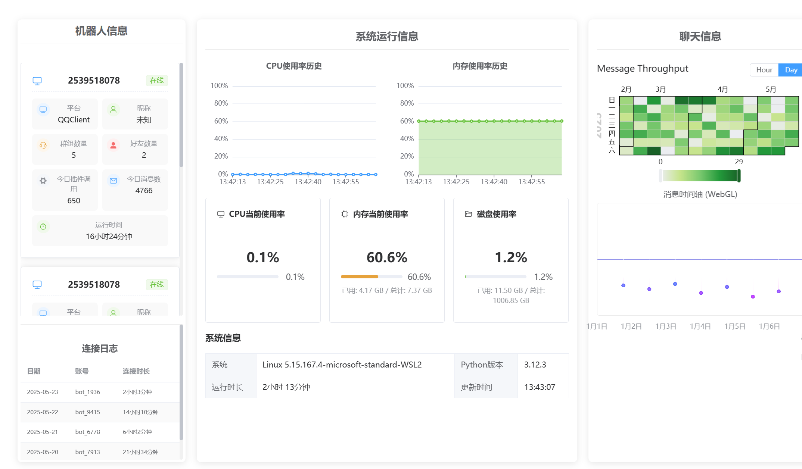
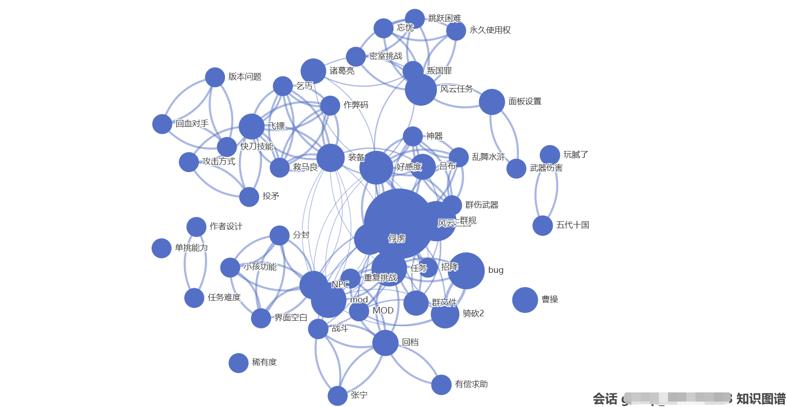

# 🤖 ATRI_PROJ QQ机器人 - 记忆型群聊智能体

基于 NoneBot2 + OpenAI + NapCatQQ 构建，具备类人记忆和自主对话能力的智能机器人

[](https://nonebot.dev/) [](LICENSE) [](https://onebot.dev/)

## 🌟 核心功能

- **长期记忆**：像真人一样记住聊天场景，告别"金鱼脑"机器人
- **智能理解**：自动分析话题脉络，对话不再答非所问
- **自动回复**：不需要@也能智能参与对话
- **回忆系统：**检索记忆，提取大脑信息
- **遗忘机制：**记忆自动衰减，遗忘不重要记忆

## 🚀 快速开始

### 环境准备

```bash
# 使用 Poetry 管理依赖（唯一入口）
poetry install
```

### 配置与统一启动

1. **配置密钥**
   修改 `data/persona/persona.yaml` 填入你的 [OpenAI API Key](https://platform.openai.com/)

   ```yaml
   api_key: "你的密钥"
   ```

2. **设置管理员**
   沿用服务器已有的 `.env.dev` / `.env.prod` 配置（统一入口会按运行模式选择）：

   ```
   SUPERUSERS=["沿用服务器现有安全配置"]
   ```

3. **启动！**
   ```bash
   .venv/bin/python scripts/manage_processes.py dev
   ```

统一进程管理器在仓库根目录管理 `napcat` 和 `atri_bot` 两个长期 screen 会话。
NapCat 使用 `xvfb-run -a qq --no-sandbox -q`，账号只在内存中从现有安装的
唯一一份账号 OneBot 配置及配套 NapCat 配置确定；不使用管理员账号推断登录账号。
多账号、缺失配置或同名非受管会话会导致启动失败，不会猜测或接管。
bot 固定通过本项目 `.venv/bin/python` 运行原有 `bot.py`，工作目录固定为仓库根目录；
开发模式选择 `.env.dev`，正式模式选择 `.env.prod`。
不会启动独立 WebUI、前端、容器或系统服务，也不会更改现有访问地址、账号或机器人配置。

### 服务器运行依赖与运维

需要 GNU screen、Bash、Xvfb（`xvfb-run`）、`xauth`、已安装并完成登录的
QQ/NapCat，以及项目 `.venv` 中的依赖。Python 依赖仍用已有 Poetry 流程安装到
项目 `.venv`；运行和测试不激活或回退到系统 Python。
非集成测试需要现有开发依赖 pytest；lint 另需 `.venv/bin/ruff`
（与现有后端 CI 相同的 `0.15.0` 版本）。
现有 `.env.dev`、`.env.prod`、`data/` 下的私有配置与 QQ/NapCat 配置继续由服务器维护，
不要把账号、密钥、配置内容或带鉴权参数的 URL 放进命令参数、仓库或日志。
QQ 所需的 `-q` 参数由管理程序内部传入；本机进程命令行仍可能由同权限用户读取，
因此不要对外分享 `ps` 的完整参数或 screen 中的原始输出。

```bash
cd /home/ubuntu/ATRI_PROJ
.venv/bin/python scripts/manage_processes.py dev        # 开发模式
.venv/bin/python scripts/manage_processes.py start      # 正式模式
.venv/bin/python scripts/manage_processes.py restart_bot # 只重启受管 bot
.venv/bin/python scripts/manage_processes.py status     # 检查服务健康状态
.venv/bin/python scripts/manage_processes.py stop       # 停止受管服务
.venv/bin/pytest -q tests -m 'not integration'        # 非集成测试
.venv/bin/ruff check src tests scripts --select E4,E7,E9,F,W291,W293 # lint
```

WebUI 地址为 `http://127.0.0.1:8080/webui`，NapCat 前端地址为
`http://127.0.0.1:6099/`；浏览器可直接访问这些地址。

`dev` 和 `start` 不是别名：两者都使用同一组 `screen` 会话和安全的生命周期管理，
但开发模式选择 `.env.dev`（当前 `LOG_LEVEL=DEBUG`）并保留两个受管进程的普通输出；
正式模式选择 `.env.prod`（当前 `LOG_LEVEL=INFO`），只把 warning/error/fatal/exception
等重要输出写入 `logs/process-manager/`，减少长期运行时的管理日志噪声。`LOG_LEVEL` 由
所选 `.env` 文件提供，入口不会另造或临时覆盖日志配置；若运维通过外部环境变量显式设置
`LOG_LEVEL`，NoneBot 的标准环境变量优先级仍然有效。若另一模式已经在运行，切换
命令会先验证归属并停止旧模式，再启动目标模式；同一模式重复执行保持幂等，不创建重复
会话。

启动后等待负载存活与 bot 监听；超时或中途退出会返回非零，并回滚本次新建的受管会话。
不会回滚此前已经健康运行的受管会话。服务未就绪时状态命令返回非零；监听成功不代表
QQ 登录、OneBot 握手或机器人业务服务均可用，仍需运维检查现有登录状态。

状态和脱敏启动日志保存在 `logs/process-manager/`（目录权限 `0700`、文件 `0600`，
已由现有 `logs/` 忽略规则排除）：`napcat.log`、`atri_bot.log`、两个服务的 `.json`
归属记录及 `manager.lock`。日志按次追加；停止命令清理归属记录，保留日志供排查。
bot 原有业务日志仍在 `logs/`；统一入口在输出格式化阶段脱敏配置值，不改变插件业务逻辑。
归属记录只存项目路径、screen 完整 ID、PID、启动时间及随机归属标记，不存配置值。
不要在运行期间删除归属记录；丢失或身份不匹配时停止会拒绝发送信号。
同名非受管会话和其他 screen 会话不在本接口停止范围内。

### NapCat 日志启动顺序

2026-10-09 检查现有 NapCat 安装代码确认：它会先创建原始日志对象，随后在
核心初始化阶段读取 `fileLog=false` 并关闭文件 transport。这是该版本 NapCat
的正常启动顺序，因此不会因为这个顺序阻止开发模式启动。入口仍要求全局及账号配置
都明确设置 `fileLog=false`，否则会在创建 screen 会话前拒绝启动；不会自动修改
NapCat 安装或配置。入口自身捕获的 NapCat 输出仍会脱敏后写入项目日志目录。

`scripts/restart/start_bot.sh` 保留为兼容入口，但现在只调用本项目进程管理器；
自动/手动重启也通过同一管理器重建 `atri_bot`，不再创建或接管旧的 `atri` 会话。
重启沿用当前受管模式，并保留 NapCat 会话。

### 🔥 首次启动必看

- 机器人上线后，私聊发送 `@机器人 状态` 检查运行状态
- 遇到问题？直接说"帮助"查看使用指南

## � 功能全景

### 🤖 Persona 人格系统（核心模块）

```text
📌 关键词触发：@机器人 记得/回忆/想起 [关键词]
```

- � 记忆系统
  - 短期上下文记忆 + 动态长期记忆
  - 自动遗忘不重要内容（像真人一样！）
- 🧠 智能对话
  - 被@必回，群聊智能判断是否参与
  - 支持私聊/群聊双模式
- ⚙️ 管理命令
  - `@机器人 系统状态`：查看系统使用情况（管理员专属）
  - `@机器人 处理`：强制处理积压消息（管理员专属）

### 🌐 WebUI 控制台（管理神器）

```bash
访问地址：http://127.0.0.1:8080/webui
默认账号：admin/admin（首次登录后须修改！）
```

- 📊 数据仪表盘：实时查看内存使用情况
- 🔍 记忆搜索引擎：按关键词/时间检索对话记录
- 🛠️ 数据库工具箱：在线执行SQL+批量操作
- 🔐 权限管理：多级用户权限控制
- ✅ 前端质量回归：Playwright smoke 已覆盖登录、模块统计、插件策略、记忆管理、数据库管理；失败时保留 screenshot/trace/video 请求日志用于定位

## 🚨 常见问题

### ❓ 机器人不响应怎么办？

1. 检查NapCatQQ是否正常连接
2. 确认已正确设置 `SUPERUSERS`
3. 查看 `data/persona/persona.yaml` 的API密钥配置

### 💾 数据存储在哪？

- 默认使用SQLite：`~/ATRI_PROJ/data/persona.db`
- 支持PostgreSQL：修改配置开启高级数据库支持

## 📚 进阶指南

| 主题          | 文档链接                                     |
| ------------- | -------------------------------------------- |
| 人格系统配置  | [persona模块文档](plugins/persona/README.md) |
| WebUI使用指南 | [WebUI文档](plugins/webui/README.md)         |
| 前端质量进展  | [前端简历亮点与扩展](docs/frontend_resume_highlights.md) |

## 后台管理



## 🕸 群组记忆图谱


